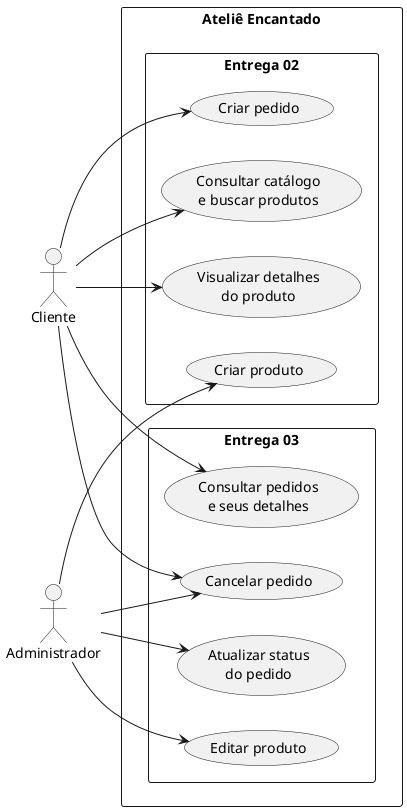
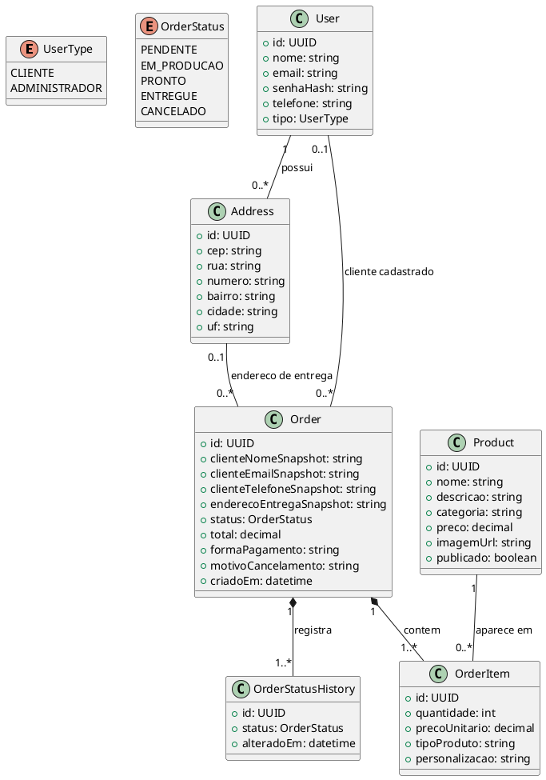

# Ateliê Encantado

Aplicativo mobile para catálogo e encomenda de produtos artesanais. O projeto possui uma área para clientes e uma área administrativa e será integrado a uma API REST e a um banco de dados PostgreSQL.

## Objetivo

Permitir que clientes conheçam os produtos do Ateliê Encantado, pesquisem e filtrem o catálogo, favoritem itens, montem um carrinho e acompanhem pedidos. A administração poderá cadastrar, editar e remover produtos, registrar a foto de um produto com a câmera do dispositivo e acompanhar os pedidos.

## Protótipo no Figma

O protótipo visual está disponível no [Figma](https://www.figma.com/design/h0Rj459fZuEKZgxicFDfzg/atelie-encantado?node-id=0-1&t=6UX2LuSximgr3LcL-1).

## Tecnologias

### Aplicativo mobile

- React Native;
- Expo SDK 57;
- Expo Router;
- TypeScript;
- React Context API.

### Back-end planejado

- Node.js;
- Express;
- TypeScript;
- PostgreSQL;
- Prisma ORM;
- Postman ou Insomnia para testar a API.

## Arquitetura

O projeto seguirá uma arquitetura cliente-servidor. O aplicativo não acessará o banco de dados diretamente: ele consumirá uma API REST, responsável pelas regras de negócio e pela persistência no PostgreSQL.

```text
Aplicativo Expo / React Native
        |
        | HTTP (JSON)
        v
API REST — Node.js / Express
        |
        | Prisma ORM
        v
Banco de dados PostgreSQL
```

Estrutura prevista para a evolução do repositório:

```text
atelie-encantado/
├── src/                         # aplicação Expo
│   ├── app/
│   ├── components/
│   └── hooks/
├── backend/                     # API REST
│   ├── prisma/
│   │   └── schema.prisma
│   └── src/
│       ├── controllers/         # recebe requisições e devolve respostas HTTP
│       ├── routes/              # define os endpoints
│       ├── services/            # regras de negócio
│       ├── middlewares/          # validação e tratamento de erros
│       └── server.ts
└── README.md                    # documentação completa do projeto
```

> O diretório `backend/` ainda será criado. Até sua integração, os dados do aplicativo permanecem em memória no `StoreContext`.

## Fluxo principal

```text
Cliente sem conta
  └─ Perfil
      ├─ Cadastrar
      │   ├─ Dados pessoais
      │   ├─ Endereço
      │   └─ Conferência → Home
      └─ Logar → Home

Cliente autenticado
  ├─ Catálogo → categoria/pesquisa → detalhes do produto
  ├─ Favoritos
  ├─ Carrinho → checkout → pedido
  └─ Perfil → dados, endereço, pedidos e conversa com vendedor

Administrador
  └─ Login administrativo → dashboard → produtos e pedidos
```

## Funcionalidades já implementadas

### Cliente

- Cadastro dividido em dados pessoais, endereço e confirmação;
- validação de campos obrigatórios e confirmação de senha;
- criação de perfil em memória após o cadastro;
- navegação por abas: Home, Favoritos, Carrinho e Perfil;
- inclusão e remoção de dois produtos de demonstração dos favoritos e do carrinho;
- exibição do primeiro nome da cliente na Home;
- navegação para Dados da Conta, Endereço de Entrega, Meus Pedidos e Conversar com o Vendedor.

### Administração

- Tela de login administrativo demonstrativa;
- redirecionamento para o Dashboard.

Credenciais de demonstração:

```text
E-mail: adm@gmail.com
Senha: Adm
```

## Funcionalidades previstas

- Listagem de produtos por categoria, busca e detalhes do produto;
- escolha de tipo do produto e finalização de compra;
- criação, histórico, detalhes, cancelamento e acompanhamento de pedidos;
- edição dos dados de conta e endereço de entrega;
- conversa com o vendedor ou integração com WhatsApp;
- logout e autenticação real;
- dashboard e gerenciamento de pedidos e produtos;
- persistência no PostgreSQL por meio da API;
- uso da câmera para registrar a foto de um produto no cadastro administrativo;
- compartilhamento de produtos pela folha de compartilhamento nativa do dispositivo.

## Casos de uso

Os oito casos abaixo foram selecionados para as Entregas 02 e 03. Cada caso representa um objetivo do ator; um caso pode usar mais de um endpoint.

| Entrega | Caso de uso | Ator principal | Endpoints previstos |
| --- | --- | --- | --- |
| 02 | Consultar catálogo e buscar produtos | Cliente | `GET /products?search=&category=` |
| 02 | Visualizar detalhes de um produto | Cliente | `GET /products/:id` |
| 02 | Criar produto | Administrador | `POST /products` |
| 02 | Criar pedido | Cliente | `POST /orders` |
| 03 | Consultar pedidos e seus detalhes | Cliente | `GET /orders/customer/:customerId`; `GET /orders/:id` |
| 03 | Editar produto | Administrador | `PUT /products/:id` |
| 03 | Atualizar status do pedido | Administrador | `PATCH /orders/:id/status` |
| 03 | Cancelar pedido | Cliente ou administrador | `PATCH /orders/:id/cancel` |

A captura de foto pela câmera faz parte do fluxo de criação do produto e não conta como um caso de uso adicional. Para a Entrega 03, o app compartilhará os dados de um produto pela folha de compartilhamento nativa do dispositivo; isso também não conta como um caso de uso adicional.

## Diagrama de Casos de Uso (UML)



## Modelo de domínio — Diagrama de Classes

O diagrama abaixo representa o domínio do back-end. Ele também orienta as tabelas e os relacionamentos no PostgreSQL.



## Banco de dados PostgreSQL

As tabelas serão implementadas em etapas. Na Entrega 02, serão criadas três tabelas. Na Entrega 03, serão adicionadas três tabelas para os novos casos de uso.

| Entrega | Tabela | Finalidade | Relações principais |
| --- | --- | --- | --- |
| 02 | `products` | Produtos disponíveis no catálogo | É referenciado por itens de pedido. |
| 02 | `orders` | Pedido e seus dados de cliente e entrega | Armazena os dados informados no checkout. |
| 02 | `order_items` | Produtos, quantidades e preços de um pedido | Pertence a um pedido e referencia um produto. |
| 03 | `users` | Clientes e administradores | Um usuário possui endereços e pedidos. |
| 03 | `addresses` | Endereços de entrega salvos | Pertence a um usuário e pode ser associado a pedidos. |
| 03 | `order_status_history` | Histórico de alterações do status | Pertence a um pedido. |

Na Entrega 02, `orders` guardará uma cópia dos dados de cliente e entrega enviados no checkout, sem depender de conta cadastrada. Na Entrega 03, `users` e `addresses` permitirão relacionar o histórico ao cliente e reutilizar endereços; `order_status_history` registrará as mudanças de status. As migrations da Entrega 02 criarão `order_id` e `product_id` em `order_items`; na Entrega 03, serão adicionadas as relações opcionais `user_id` e `address_id` em `orders`, além de `order_id` em `order_status_history`. O preço unitário será salvo em `order_items` para preservar o valor da compra caso o preço do catálogo seja alterado posteriormente.

## API REST planejada

Base local de desenvolvimento: `http://localhost:3333`.

| Caso de uso | Método | Rota | Resposta esperada |
| --- | --- | --- | --- |
| Listar ou buscar produtos | `GET` | `/products?search=&category=` | Lista de produtos. |
| Consultar detalhes do produto | `GET` | `/products/:id` | Produto selecionado. |
| Criar produto | `POST` | `/products` | Produto criado. |
| Editar produto | `PUT` | `/products/:id` | Produto atualizado. |
| Excluir produto | `DELETE` | `/products/:id` | Resposta sem conteúdo. |
| Criar pedido | `POST` | `/orders` | Pedido criado com itens. |
| Consultar pedidos do cliente | `GET` | `/orders/customer/:customerId` | Histórico de pedidos. |
| Consultar detalhes do pedido | `GET` | `/orders/:id` | Pedido e seus itens. |
| Atualizar status do pedido | `PATCH` | `/orders/:id/status` | Pedido com status atualizado. |
| Cancelar pedido | `PATCH` | `/orders/:id/cancel` | Pedido com status `CANCELADO`. |

Exemplo de corpo para criar um pedido:

```json
{
  "customer": {
    "nome": "Nome do cliente",
    "email": "cliente@example.com",
    "telefone": "11999999999"
  },
  "delivery": {
    "modo": "ENTREGA",
    "cep": "01000-000",
    "rua": "Rua Exemplo",
    "numero": "123",
    "bairro": "Centro",
    "cidade": "São Paulo",
    "uf": "SP"
  },
  "formaPagamento": "PIX",
  "items": [
    {
      "productId": "uuid-do-produto",
      "quantidade": 1,
      "tipoProduto": "Completo"
    }
  ]
}
```

## Integração com recurso do dispositivo

**Entrega 02 — câmera:** no fluxo administrativo **Criar Produto**, o aplicativo solicitará permissão para usar a câmera. A foto capturada será mostrada como prévia no formulário e enviada ou associada ao produto cadastrado.

**Entrega 03 — compartilhamento nativo:** na tela de detalhes do produto, o cliente poderá abrir a folha de compartilhamento do dispositivo para enviar o nome, a descrição, o preço e o link ou identificador do produto por um aplicativo disponível. O app usará a API `Share` do React Native, sem exigir uma dependência adicional.

## Estado atual e integração futura

Hoje, `src/app/context/StoreContext.tsx` guarda o perfil, favoritos e carrinho somente em memória. Na integração:

1. a Home e as categorias chamarão `GET /products`;
2. o checkout enviará o carrinho para `POST /orders`;
3. Meus Pedidos consumirá `GET /orders/customer/:customerId`;
4. o Dashboard atualizará pedidos por `PATCH /orders/:id/status`;
5. Criar Produto enviará os dados e a foto para `POST /products`.

## Estrutura atual de telas

```text
src/app/
├── context/
│   └── StoreContext.tsx
├── loguin/
│   ├── cadastro.tsx
│   ├── logar-adm.tsx
│   └── logar-cliente.tsx
├── telas-adm/
│   └── Dashboard.tsx
└── telas-cliente/
    ├── index.tsx
    ├── favoritos.tsx
    ├── carrinho.tsx
    ├── perfil.tsx
    ├── dados-conta.tsx
    ├── endereco-entrega.tsx
    ├── meus-pedidos.tsx
    └── conversar-vendedor.tsx
```

## Como executar o aplicativo

1. Entre na pasta do projeto:

```bash
cd atelie-encantado
```

2. Instale as dependências:

```bash
npm install
```

3. Inicie o Expo:

```bash
npm start
```

4. Abra no Expo Go, em um emulador ou no navegador.